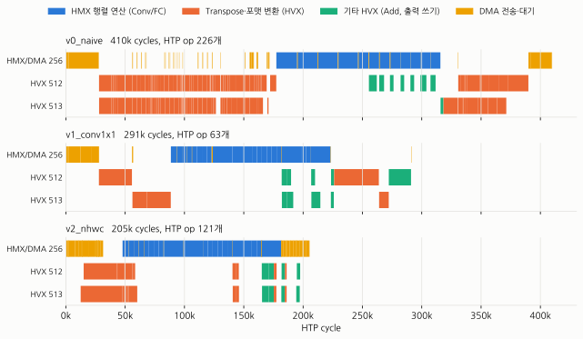

# Week 1: QNN/HTP 실행 구조와 Optrace

## 이번 주 목표

ONNX 모델이 QNN을 거쳐 HTP(Hexagon NPU)에서 실행되는 과정을 따라가고, HTP 안에서 무슨 일이 일어나는지 Optrace로 봅니다.

같은 FFN 블록을 세 가지 그래프로 만들어 Rubik Pi 3에서 실행합니다.

- v0 naive: PyTorch식으로 flatten/Transpose 후 Linear
- v1: Linear를 1×1 Conv로
- v2: 입출력을 NHWC로 바꿔 Transpose 제거

계산은 같은데 HTP 실행 시간이 1.7배 차이 납니다. 그 이유를 Optrace에서 찾는 것이 이번 주 목표입니다.

## 알아야 할 개념

- Host / 보드: Host(x86)에서 모델을 HTP용으로 미리 컴파일하고, 보드는 결과를 로드해서 실행만 합니다
- Context Binary: HTP용 컴파일이 끝난 그래프와 가중치가 든 파일. 보드는 이 파일만 있으면 됩니다
- QNN 객체: Backend(`libQnnHtp.so`) → Device(HTP, 전력 설정) → Context(Context Binary) → Graph(그래프 이름으로 찾음) → Tensor(입출력 버퍼)
- CPU와 cDSP: QNN API는 Arm CPU에서, 그래프 실행은 별도 프로세서인 Hexagon cDSP(HTP)에서 일어납니다. 둘은 FastRPC로 통신합니다
- HMX / HVX: HMX는 행렬 곱 전용 유닛, HVX는 벡터 유닛입니다. Conv와 Linear는 HMX, Transpose나 포맷 변환은 HVX가 합니다
- VTCM / DMA: VTCM은 연산 직전 데이터를 두는 HTP 옆 메모리(이 보드 2 MB), DMA는 DRAM과 VTCM 사이 복사입니다
- Optrace: HTP 안에서 실행된 op(compiled HTP op)마다 시작 cycle, 길이, 스레드, 자원을 기록합니다. CPU 쪽과 FastRPC는 보이지 않습니다
- QHAS: Optrace를 표로 요약한 것(`qhas.json`)입니다
- dominant path: 매 순간 실행 중인 op 중 우선순위가 가장 높은 op에 cycle을 배정한 값입니다. 우선순위는 HMX > HVX > DMA 순입니다. 겹쳐서 숨은 시간은 빠지므로, op가 실제로 전체 시간에 기여한 몫을 볼 때 씁니다
- ONNX op ≠ QNN op ≠ HTP op: 변환기와 컴파일러가 합치고 나누고 배치를 바꿉니다. QNN 그래프 하나가 HTP op 63~226개가 됩니다

## 실행 흐름

```
[Host]  make_models.py ─> ONNX 3개
        qnn-onnx-converter ─> qnn-model-lib-generator ─> qnn-context-binary-generator
                                                          ─> Context Binary (일반 / Optrace + schematic)
[보드]  bench_graph   Context 로드 → graphExecute 반복 → 시간 + HTP 실행 시간
        qnn-net-run   Optrace Context로 21회 실행 → Optrace 로그
[Host]  qnn-profile-viewer + schematic ─> optrace.json, qhas.json, runtrace.json
        analyze.py ─> 결과 표, 타임라인 그림
```

## 읽는 순서

| 파일 | 볼 것 |
|---|---|
| [make_models.py](../../../tools/make_models.py) | 같은 가중치로 v0/v1/v2를 만드는 법. Linear 가중치를 1×1 Conv 커널로 바꾸는 줄 |
| [run.sh](../../../tools/run.sh) | 변환 옵션: v0/v1의 `--preserve_io layout`과 v2의 `--input_layout x NHWC`, Optrace Context 생성 옵션 |
| [bench_graph.cpp](../../../tools/bench_graph.cpp) | QNN API 호출 순서(Backend → Device → Context → Graph → `graphExecute`), 전력 burst 설정, 시간 측정 |
| [board.sh](../../../tools/board.sh) | 워밍업과 반복 횟수, `taskset`, Optrace 21회 실행 |
| [analyze.py](../../../tools/analyze.py) | `qhas.json`, `runtrace.json`에서 어떤 값을 꺼내 표와 그림을 만드는지 |
| `results/week_1/optrace/<v>/` | `optrace.json`(Perfetto나 QAIRT Visualizer에서 열기), `qhas.json` |

## 실행

```bash
source <QAIRT>/bin/envsetup.sh
BOARD=root@<보드 IP> bash tools/run.sh        # 결과: work/runs/<시각>/ (준비물은 README)
python3 tools/analyze.py results/week_1        # 저장된 결과만 다시 분석 (보드 없이)
```

## 측정해볼 것

| 대상 | 관찰 포인트 |
|---|---|
| 결과 표 | HTP 실행은 1.7배 줄었는데 graphExecute는 왜 1.4배만 줄었나? |
| 타임라인 그림 | v0에서 HMX(파랑)는 언제 시작하나? 그 앞을 채우는 주황(HVX)은 무엇인가? v1, v2에서는? |
| `qhas.json` | `cycles`와 `num_dominant_path_cycles`가 크게 다른 op는? 왜 다른가? |
| `qhas.json` | 세 그래프의 `q::ConvLayer_s1.opt` cycle은 얼마나 다른가? |
| `runtrace.json` | 21회 실행 중 첫 회의 Inference cycle은 나머지와 얼마나 다른가? |

`qhas.json`은 이렇게 열어볼 수 있습니다.

```python
import json
d = json.load(open("results/week_1/optrace/v0_naive/qhas.json"))["data"]
for t in d["htp_op_types"]["data"][:8]:
    print(t["op"], t["instances"], t["cycles"], t["num_dominant_path_cycles_htp_0"])
```

## 바꿔볼 만한 것

- `optrace.json` 보기: Perfetto에서 열고, v0의 `q::Transpose_impl`이 HVX 두 스레드(512, 513)에서 어떻게 겹치는지 보기
- CPU 코어 바꾸기: [board.sh](../../../tools/board.sh)의 `taskset -c 7`을 `-c 0`(작은 코어)으로 바꾸면 graphExecute와 HTP 실행 중 무엇이 변하나?
- 워밍업 없애기: [board.sh](../../../tools/board.sh)의 `WARMUP`을 0으로 바꾸면 trial 중앙값은? 첫 몇 회만 따로 보면?
- HTP 밖 시간 나누기: 새로 측정한 결과의 `latency/<v>.csv`에는 `host_rpc`, `htp_rpc`, `qnn_execute`도 있습니다. graphExecute와 HTP 실행의 차이를 구간별로 나눠 보기

## 토의 거리

- v2는 HTP op가 v1보다 많은데 빠르다. op 수, 실행 cycle, dominant path 중 무엇을 봐야 하나?
- graphExecute와 HTP 실행의 차이(약 300 µs)를 줄이려면 무엇을 바꿔야 하나? (공유 버퍼, 호출 횟수)
- dominant path는 critical path와 어떻게 다른가? dominant path만 보고 "이 op를 없애면 이만큼 빨라진다"고 말할 수 있나?

## 참고: 기준 측정값

Rubik Pi 3 (QCS6490, HTP v68), QAIRT 2.35, HTP 전력 burst에서 측정한 값입니다(`results/week_1`).

<details>
<summary>결과 표</summary>

| 단계 | graphExecute (trial 범위) | HTP 실행 | Optrace cycle | HTP op 수 |
|---|---:|---:|---:|---:|
| v0 naive | 650 µs (558~899) | 269 µs | 376k | 226 |
| v1 1×1 Conv | 542 µs (490~571) | 197 µs | 267k | 63 |
| v2 NHWC | 470 µs (449~542) | 160 µs | 218k | 121 |

- graphExecute: 프로세스마다 워밍업 100회 후 300회, 프로세스 10개의 중앙값
- HTP 실행: QNN basic profile `Accelerator (execute) time`
- Optrace cycle: 21회 중 첫 회를 뺀 중앙값
- 세 그래프 모두 FP32 기준 SQNR 34.2 dB

</details>

<details>
<summary>Optrace 타임라인 (첫 실행)</summary>



| 단계 | `ConvLayer` dominant | 첫 `ConvLayer` 시작 | HVX `cycles` 합 | 배치 변환 dominant |
|---|---:|---:|---:|---:|
| v0 | 133,505 | 177k | 419k | 218k |
| v1 | 132,733 | 89k | 158k | 106k |
| v2 | 132,299 | 48k | 140k | 37k |

행렬 곱 비용은 같습니다. 줄어든 것은 HMX 앞뒤를 채우던 HVX 배치 변환입니다.

</details>
