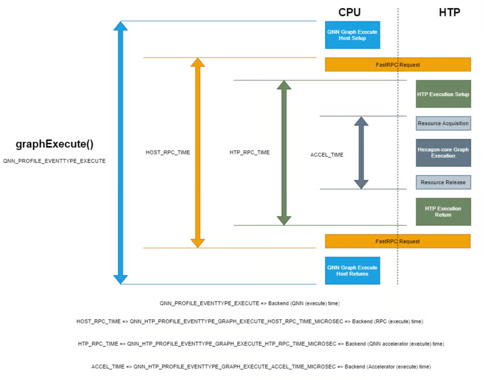
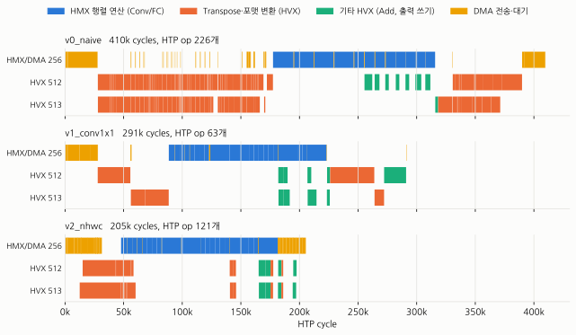

# Week 1. QNN/HTP 실행 구조와 Optrace

## 목표

ONNX 모델이 QNN을 거쳐 HTP에서 실행되는 과정을 이해하고, Optrace를 통해 Graph 표현과 Tensor Layout이 실행 성능에 미치는 영향을 분석한다.

같은 FFN을 세 가지 Graph로 구성했을 때 HTP 실행 시간은 269 → 197 → 160 µs로 감소했다. 무엇이 바뀌었는지 확인하는 방법에 대해 살펴보자.

---

## 1. 실험 모델: 같은 계산, 다른 Graph

```text
Y = X + (ReLU(XW1 + b1))W2 + b2

Input: 32 × 32 = 1,024 tokens, 256 channels
FFN:   256 → 1,024 → 256
```

| 모델 | ONNX Graph 구성 | 입출력 Layout |
|---|---|---|
| v0 naive | Reshape/Transpose → MatMul + Bias 기반 FFN → Transpose/Reshape | NCHW `[1,256,32,32]` |
| v1 Conv | 1×1 Conv 기반 FFN | NCHW `[1,256,32,32]` |
| v2 NHWC | 1×1 Conv 기반 FFN, NHWC 입출력 | NHWC `[1,32,32,256]` |

### Linear → 1×1 Conv

Linear는 각 Token에 동일한 Weight를 적용한다. 1×1 Conv 역시 각 공간 위치의 Channel Vector에 동일한 Weight를 적용하므로 수학적으로 같은 계산을 표현할 수 있다.

```python
# v0: NCHW → [N, H*W, C]
t = x.flatten(2).transpose(1, 2)
y = t + linear2(relu(linear1(t)))
y = y.transpose(1, 2).reshape(1, 256, 32, 32)

# v1: NCHW 유지 (Conv는 Bias를 포함)
y = x + conv2(relu(conv1(x)))
```

MatMul Weight `[C_in, C_out]`를 전치하고 `[C_out, C_in, 1, 1]`로 변환하면 1×1 Conv의 Kernel이 된다. Weight 변환은 모델 생성 시 수행한다.

### NCHW → NHWC

- v0/v1: `--preserve_io layout`으로 NCHW 입출력을 유지한다.
- v2: `--input_layout x NHWC`로 NHWC 입력임을 명시한다. 표준 ONNX Conv를 위해 Graph에 넣은 Transpose는 QNN 변환 및 HTP 최적화 과정에서 별도 실행 Op로 남지 않았다.

| 구분 | v0 | v1 | v2 |
|---|---|---|---|
| ONNX의 주요 연산 | MatMul, Add | Conv | Conv, 입출력 Transpose |
| QNN의 주요 연산 | FullyConnected, Reshape, Transpose | Conv2d, Transpose | Conv2d |
| 실제 HTP Transpose | 40개 | 4개 | 0개 |

세 모델의 원본 Weight와 계산은 동일하며, `make_models.py`에서 ONNX Reference 출력의 일치 여부를 확인한다. 양자화는 W8A8, Calibration 입력은 8개를 사용한다.

---

## 2. QNN 실행 구조

### Host에서 컴파일, 보드에서 실행

```text
[Host: x86]
ONNX
  ↓ qnn-onnx-converter (W8A8 양자화)
.cpp (Graph 구성 코드) + .bin (Weight 등 상수)
  ↓ qnn-model-lib-generator
Model Library (.so)
  ↓ qnn-context-binary-generator + libQnnHtp.so
Context Binary (.bin) + schematic.bin (Optrace용)

[Board: aarch64]
Context Binary → contextCreateFromBinary → graphRetrieve → graphExecute
```

- Model Library: 모델별 Graph 구성 코드와 Weight를 제공한다.
- HTP Backend (`libQnnHtp.so`): QNN Graph를 HTP에 맞게 준비하고 컴파일·실행하는 범용 Backend다.
- Context Binary: HTP용으로 컴파일 및 직렬화된 Graph와 상수를 담는다. Converter가 생성한 Weight `.bin`과는 다른 파일이다.


### CPU와 cDSP

```text
Arm CPU (Linux)                         Hexagon cDSP
bench_graph                            HTP Runtime
 ├ libQnnHtp.so                         libQnnHtpV68Skel.so
 ├ libQnnSystem.so                      libQnnHtpV68.so
 └ libQnnHtpV68Stub.so ── FastRPC ────→ HMX / HVX / DMA / VTCM
```

QNN API는 Arm CPU에서 호출되고 Graph는 cDSP에서 실행된다. `graphExecute`는 동기 호출이므로 HTP 실행뿐 아니라 CPU 측 Runtime 처리, FastRPC 요청 및 응답 등의 시간도 포함한다.

---

## 3. HTP Hardware 구조

```text
System DRAM ↔ DMA ↔ VTCM ↔ HMX (Matrix)
                         ↔ HVX (Vector)
```

| 자원 | 역할 | 이번 실험에서 관측한 Op |
|---|---|---|
| HMX | 행렬 연산 | `q::ConvLayer_s1.opt` |
| HVX | 벡터 연산 및 데이터 재배치 | `Transpose`, `ForceFormat`, `Add` |
| VTCM | 연산에 필요한 데이터 및 중간 결과를 저장하는 On-chip Memory | 입력, Weight, Activation |
| DMA | 데이터 이동 | `InputSlice`, `weights_to_vtcm`, `OutputSlice` |

실행 과정은 개념적으로 입력·Weight 전송 → 내부 Format 변환 → HMX 계산 → 후처리 및 출력 전송으로 구성된다. 실제로는 Tensor를 여러 조각으로 나누고 DMA, HVX, HMX 작업을 중첩하여 실행한다.

- `DmaCheckpointSet/Wait`, `SyncOp`: DMA 및 연산 사이의 실행 순서를 제어한다.
- `ForceFormat_Crouton`: HTP 내부 Format 변환 작업이다. NHWC라고 해서 내부 Format 변환이 모두 제거되는 것은 아니다.

---

## 4. Profiling과 Optrace

### Profiling 방법 비교

| 도구 | 측정 단위 | 확인할 수 있는 정보 |
|---|---|---|
| Host Timer | API 호출 | `graphExecute` 전체 시간 |
| QNN Basic | Graph | QNN, FastRPC, HTP 실행 관련 시간 |
| QNN Detailed | QNN Op | Op별 Cycle |
| QNN Linting | QNN Op | 실행, Wait, Overlap |
| HTP Optrace | HTP Op | Timeline, Thread, 사용 자원, 메모리 지표 |
| QHAS | Optrace 분석 결과 | Op별 Cycle 및 Dominant Path 요약 |




Optrace는 컴파일된 HTP Op의 실행을 관찰하는 도구다. CPU 측 함수나 HTP 명령어 단위까지 보여주는 Profiler는 아니다.

### Optrace 수집 과정

```text
[Host]  qnn-context-binary-generator (optrace 옵션)
        → Optrace Context Binary + schematic.bin
[Board] qnn-net-run (optrace 옵션, 21회 실행)
        → qnn-profiling-data_0.log
[Host]  qnn-profile-viewer + schematic + Optrace Reader
        → optrace.json / qhas.json / runtrace.json
```

| 결과 파일 | 분석 내용 |
|---|---|
| `optrace.json` | Perfetto에서 HTP Op Timeline 확인 |
| `qhas.json` | HTP/QNN Op별 정량적 분석 |
| `runtrace.json` | 각 Graph 실행의 Inference Cycle 및 자원 확보 구간 |

일반 실행 성능은 계측이 없는 Plain Context로 별도 측정한다.

### ONNX Op ≠ QNN Op ≠ HTP Op

Converter와 HTP Compiler는 Graph를 변환하면서 연산을 결합하거나 분할하고, Layout 변환을 삽입하거나 제거한다.

| v0 ONNX | QNN Operator Type | HTP 실행 예시 |
|---|---|---|
| Reshape, Transpose | Reshape, Transpose | `Transpose_impl`, `SlicePad`, `ForceFormat_Crouton` |
| MatMul, Add, ReLU | FullyConnected, Activation 등 | `ConvLayer_s1.opt`, Weight 전송 등 |
| Residual Add | Eltwise_Binary | `Add.tcm` 등 |

QHAS에서 첫 번째 행렬 곱이 `Relu_0`에 귀속되어 나타난다. 이는 Fusion의 결과로 해석할 수 있지만, QHAS의 Op 소속이 원본 Graph 경계와 항상 일치하는 것은 아니다.

---

## 5. QHAS 읽기

### 주요 필드

| 필드 | 의미 |
|---|---|
| `htp_op`, `qnn_op` | HTP Op 이름 및 상위 QNN Op 소속 |
| `tid` | 실행 Thread (이번 결과: 256, 512, 513) |
| `start_cycle`, `cycles` | 시작 Cycle 및 실행 길이 |
| `hmx`, `hvx`, `dma` | 사용한 Hardware Resource |
| `dram_read/write`, `vtcm_read/write` | 메모리 읽기·쓰기 바이트 지표 |
| `num_dominant_path_cycles` | Dominant Path에 배정된 Cycle |


### Dominant Path

여러 Thread의 Op가 동시에 실행되므로 `cycles`를 단순 합산하면 중첩된 시간이 중복 계산된다. QHAS의 Dominant Path는 매 시점에 실행 중인 Op 중 우선순위가 높은 Op에 Cycle을 배정한다.

```text
HMX > HVX > DMA Read > DMA Write > DmaCheckpointSet/Wait > SyncOp
```

예를 들어 HMX가 100 Cycle, HVX가 80 Cycle 실행되고 40 Cycle이 중첩되면 전체 길이는 140 Cycle이다. 이때 HMX에 100 Cycle, HVX에 40 Cycle이 배정된다.

Dominant Path는 의존성을 기준으로 구한 Critical Path와 다르다. 따라서 Dominant Cycle을 그대로 제거 가능한 실행 시간으로 해석하면 안 된다.

### 예시: v0의 `q::Transpose_impl`

| 항목 | 측정값 |
|---|---:|
| 실행 개수 | 40개 (HVX Thread 512/513 각각 20개) |
| `cycles` 합 | 216,717 |
| Dominant Cycle | 109,325 |
| HMX 연산과의 중첩 | 0 Cycle |

두 HVX Thread의 작업이 중첩되어 전체 Cycle 합보다 Dominant Cycle이 작다. 첫 Transpose 구간에는 HMX 계산이 실행되지 않았으므로, 데이터 준비 비용을 줄이면 HMX가 더 일찍 실행될 가능성이 있다.

---

## 6. 실험 결과와 해석

### 측정 조건

Rubik Pi 3 (QCS6490, HTP v68), QAIRT 2.35, W8A8, HTP burst.

| 측정 항목 | 방법 |
|---|---|
| graphExecute | Warmup 100회 후 300회 측정 × 10 Trial |
| HTP 실행 | 각 Trial에서 Basic Profile 20회 (`Accelerator (execute) time`) |
| Inference Cycle | Runtrace 21회 중 첫 회 제외 |
| Op Timeline / QHAS | Optrace 첫 실행 |

각 실행 시간은 중앙값을 기준으로 비교한다. Runtrace의 반복 실행 통계와 QHAS Timeline은 서로 다른 회차의 결과다.

### 전체 성능

| 모델 | graphExecute (Trial 범위) | HTP 실행 | Inference Cycle | HTP Op 수 |
|---|---:|---:|---:|---:|
| v0 naive | 650 µs (558~899) | 269 µs | 376k | 226 |
| v1 Conv | 542 µs (490~571) | 197 µs | 267k | 63 |
| v2 NHWC | 470 µs (449~542) | 160 µs | 218k | 121 |

v0 대비 v2의 HTP 실행 시간은 약 40.5% 감소(1.68배 Speedup), graphExecute는 약 27.7% 감소(1.38배 Speedup)했다. 측정 당시 세 모델의 FP32 기준 SQNR은 모두 34.2 dB였다(출력 원본은 저장소에 없음).

### Optrace Timeline



| 모델 | ConvLayer Dominant | 첫 ConvLayer 시작 | HVX Cycle 합 | 배치 변환 Dominant |
|---|---:|---:|---:|---:|
| v0 | 133.5k | 177k | 419k | 218k |
| v1 | 132.7k | 89k | 158k | 106k |
| v2 | 132.3k | 48k | 140k | 37k |

- **v0 → v1:** `Transpose_impl` 40개가 사라졌지만 NCHW 입출력을 위한 `Transpose.2D` 4개가 남았다. Linear → Conv 변환과 Layout 처리 방식이 함께 바뀌었다.
- **v1 → v2:** 별도 `Transpose.2D`가 사라졌다. HTP Op 수는 63개에서 121개로 늘었지만 전체 실행 시간은 감소했다.

HMX 행렬 연산 비용은 거의 동일하다. 주요 차이는 배치 변환 관련 작업과 실행 Timeline에서 관측된다. 첫 HMX 시작이 앞당겨졌으며, 배치 변환에 배정된 Dominant Cycle이 크게 감소했다. 단, 각 최적화의 독립적인 기여도는 이 실험만으로 분리할 수 없다.


---

## 7. 정리 및 다음 주차

- ONNX, QNN, HTP의 Op는 일대일로 대응하지 않는다.
- 동일한 계산도 Graph 표현과 Tensor Layout에 따라 HTP 실행 성능이 달라진다.
- Optrace 분석에서는 Op 수나 Cycle 합뿐 아니라 Resource 사용, 중첩 및 Dominant Path를 함께 봐야 한다.

**Week 2:** RAW Buffer와 Shared Buffer의 차이, Memory Registration, Zero-copy를 통해 Device 간 데이터 전달 및 Runtime 비용을 분석한다.

### 실습

```bash
python3 tools/analyze.py results/week_1
```

- `tools/make_models.py`: 모델 구성 및 동등성 확인
- `tools/run.sh`, `tools/board.sh`: 컴파일, 실행, Profiling
- `tools/bench_graph.cpp`: QNN API 및 Latency 측정
- `tools/analyze.py`: QHAS, Runtrace 분석

